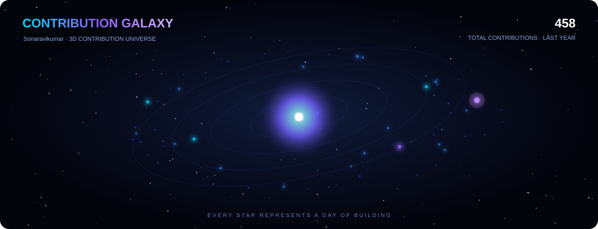

  

  # Sona Pandi

  **Backend & AI Developer** · Madurai, Tamil Nadu, India

  
  
  

## 👋 About me

Backend developer building scalable APIs and AI-integrated systems since January 2025. I work mostly with Node.js, Express.js, MongoDB and RabbitMQ, and I integrate third-party services such as OpenAI, WhatsApp Cloud API and Razorpay.

- Software Developer (Backend) at **Zevotria**
- Interested in backend architecture, applied AI, asynchronous processing and scalable services
- Currently contributing to **Kellygang.AI**, an AI movie creation platform

## 🛠️ Tech stack

**Backend:** Node.js · Express.js · JavaScript · TypeScript

**Data and queues:** MongoDB · PostgreSQL · Redis · RabbitMQ

**Integrations:** OpenAI API · WhatsApp Cloud API · Razorpay · ElevenLabs

**Frontend and tools:** React · GrapesJS · HTML/CSS · Git · Postman · VS Code

## 💼 What I do at work

- Build and maintain REST APIs with Node.js, Express.js and MongoDB
- Implement JWT authentication and role-based access control (RBAC) for protected APIs
- Design rate-limited API architectures to protect services from abusive traffic
- Build asynchronous workflows with RabbitMQ, including retry and failure handling
- Process webhooks, send email notifications and run scheduled campaign automation
- Integrate OpenAI, WhatsApp Cloud API and Razorpay
- Investigate production issues and improve backend reliability and performance

## 🚀 Experience

### Software Developer, Backend · Zevotria

**January 2025 – Present** · Madurai, Tamil Nadu

- Developed and maintained REST APIs with Node.js, Express.js and MongoDB
- Implemented authentication, authorization and RBAC
- Designed rate-limited API architectures
- Built asynchronous workflows with RabbitMQ
- Integrated OpenAI, Meta WhatsApp Cloud API and Razorpay
- Developed webhook processing, email notifications and scheduled campaign automation
- Investigated production issues and improved backend reliability and performance

### Frontend Intern · Lithi Info Tech

**January 2024 – April 2024** · Madurai, Tamil Nadu

- Practiced React.js fundamentals and built reusable UI components
- Assisted with debugging and feature enhancements

## 📌 Featured projects

### CareerPro: AI-powered career management platform

- **Problem:** Career tasks such as resumes, LinkedIn optimization, interview preparation and job tracking are scattered across separate tools.
- **Solution:** Backend APIs for AI-assisted resume generation, LinkedIn optimization, interview preparation and job tracking.
- **My role:** Backend design, authentication, subscriptions and usage tracking.
- **Stack:** Node.js · Express.js · MongoDB · OpenAI API
- **Outcome:** ~10 daily active users; 50+ resumes generated
- **Links:** [Live demo](https://careerpro-ai.com/)

### Inderact: WhatsApp Business automation platform

- **Problem:** Businesses handle WhatsApp replies and campaigns manually.
- **Solution:** Automated replies, campaign management and event-driven messaging workflows.
- **My role:** Webhook processing, RabbitMQ background jobs and WhatsApp Cloud API integration.
- **Stack:** WhatsApp Cloud API · RabbitMQ · Webhooks · Node.js
- **Outcome:** Handles ~56 automated messages per day; campaign scheduling runs automatically without manual sending

### Kellygang.AI: AI movie creation platform *(ongoing)*

- **Scope:** Script generation, storyboards and asset management.
- **My role:** Contributions to LLM, image, audio and video generation integrations and creative workflows.
- **Links:** [Live demo](https://kellygang.ai/)

### Website Builder Platform

- **Solution:** No-code website creation, editing and publishing.
- **Stack:** React.js · GrapesJS · Node.js · Express.js · MongoDB
- **Links:** [GitHub repository](https://github.com/Sonaravikumar/website) · [Live demo](https://website-builder-2026.netlify.app)

### AI Gen Studio: AI marketing content platform

- **Solution:** Backend APIs for AI-powered marketing content generation, post ideation and automation workflows.
- **Links:** [API demo](https://aigenstudio-server.onrender.com/) · [GitHub repository](https://github.com/Sonaravikumar/aigenstudio_server)

## 🎓 Education

| Qualification | Institution | Year | Result |
|---|---|---:|---:|
| M.Sc. Computer Science | Thiagarajar College of Arts and Science | 2024 | 8.6 CGPA |
| B.Sc. Information Technology | Nadar Mahajana Sangam S. Vellaichamy Nadar College | 2022 | 8.3 CGPA |

## 📜 Certifications

- Getting Started with NodeJS, Simplilearn SkillUp (June 2025)
- Introduction to Express JS, Simplilearn SkillUp (June 2025)
- AI for India 2.0, GUVI (August 2023)
- HTML Training, Spoken Tutorial Project, IIT Bombay (June 2021)

## 📈 GitHub activity

## 🌌 3D Contribution Galaxy

  

   

  <i>Every star represents a day of building, learning and creating.</i>

## 📈 GitHub Activity

  

  

## 🤝 Let's connect

Open to backend engineering, platform engineering and applied AI opportunities.

[Email](mailto:sonaravikumar2872@gmail.com) · [LinkedIn](https://www.linkedin.com/in/sonapandi-ravikumar) · [Portfolio](https://sonarportfolio.netlify.app/)
